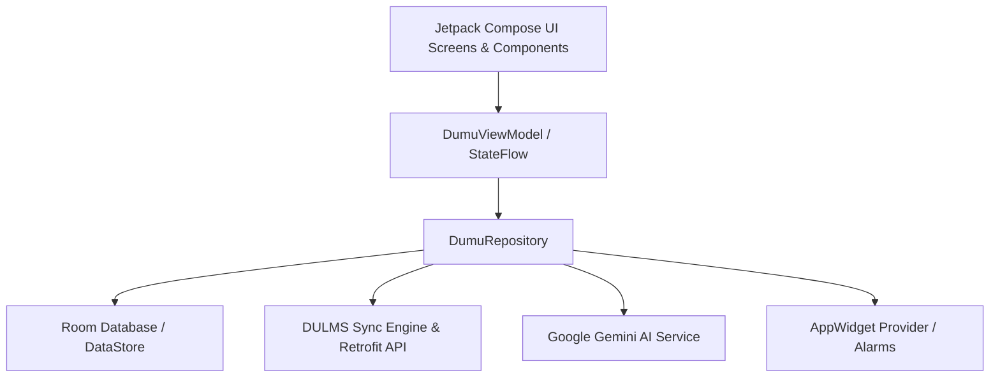

# 📱 DUMU v2 - Delta University Mobile Utility

<div align="center">


<p align="center">
  <b>تطبيق أندرويد متكامل وشامل لطلاب جامعة الدلتا (Delta University). يجمع بين المساعد الذكي المدعوم بـ Google Gemini، مزامنة جدول المحاضرات والمهام مع نظام DULMS، أدوات المذاكرة (Pomodoro & Audio Recorder & Image-to-PDF)، والـ Home Screen Widget.</b>
</p>

</div>

---

## 🏛 Architecture Overview | الهيكلة والمعمارية

تم بناء التطبيق باتباع معمارية **Clean Architecture (MVVM)** الحديثة الموصى بها رسمياً من Google، مع فصل كامل بين طبقات البيانات والعرض:



---

## ✨ Key Features | الميزات الرئيسية

### 1. 📅 Smart Schedule & Timeline
- جدول تفاعلي ذكي لجميع المحاضرات والسكاشن الأسبوعية مع مؤشر فوري للوقت المتبقي لكل محاضرة.
- تنبيهات مسبقة قابلة للتخصيص عبر `AlarmManager` و `BroadcastReceiver`.
- دعم استيراد وتصدير الجداول (Import/Export Schedule).

### 2. 🔄 DULMS Sync Engine
- مزامنة آلية مع بوابة التعلم الأكاديمي بجامعة الدلتا (DULMS).
- جلب التكليفات والواجبات والمواعيد النهائية وتنبيه الطالب بها في لوحة التحكم (Dashboard).

### 3. 🤖 AI Assistant (Powered by Gemini)
- مساعد دراسي مدمج للإجابة على الأسئلة الأكاديمية وشرح المفاهيم المعقدة.
- تلخيص المحاضرات والمذكرات الدراسية بدقة وسرعة.

### 4. 🧰 Student Productivity Toolkit
- 📸 **Image to PDF Converter:** مسح وتجميع أوراق المحاضرات وتحويلها فوراً إلى مستندات PDF من الكاميرا أو المعرض (CameraX).
- 🎙 **Lecture Audio Recorder:** مسجل صوتي مدمج للمحاضرات مع إدارة سهلة للتسجيلات.
- ⏱ **Pomodoro Focus Timer:** مؤقت تركيز مصمم لزيادة الإنتاجية وتقسيم أوقات المذاكرة وفترات الراحة.

### 5. 📲 Home Screen Widget
- ودجت لشاشة الهاتف الرئيسية يعرض المحاضرة القادمة تلقائياً دون الحاجة لفتح التطبيق.

---

## 🛠 Tech Stack & Libraries | التقنيات والمكتبات

| المجال | المكتبة / التقنية |
| :--- | :--- |
| **Language** | Kotlin 2.2.10 (Modern Coroutines & StateFlow) |
| **UI Framework** | Jetpack Compose + Material 3 + Navigation Compose |
| **Local Database** | Room DB (Entity, DAO, TypeConverters with KSP) |
| **Network & Sync** | Retrofit 2 + Moshi Converter + OkHttp Logging Interceptor |
| **Cloud Services** | Firebase Auth + Firestore + Firebase AI (Gemini) + App Check |
| **Camera & Media** | CameraX (Camera2, Lifecycle, View) + Coil Compose (Image Loading) |
| **Local Storage** | Jetpack DataStore Preferences |
| **Authentication** | Google Credential Manager (One-Tap Sign-in) |

---

## 📂 Project Structure | هيكل المشروع

```plaintext
DUMO2/
├── app/
│   ├── src/main/java/com/example/
│   │   ├── data/
│   │   │   ├── local/          # Room DB, Daos, PreferenceManager
│   │   │   ├── model/          # Data Models (Course, Assignment, Task)
│   │   │   └── repository/     # Single Source of Truth Repository
│   │   ├── network/            # DULMS Engine & Update Checker
│   │   ├── receiver/           # Alarm & Notification Receivers
│   │   ├── ui/
│   │   │   ├── components/     # Reusable Compose Widgets
│   │   │   ├── screens/        # Dashboard, Schedule, Tools, MediaHub
│   │   │   └── theme/          # Material 3 Colors, Shapes, Typography
│   │   ├── viewmodel/          # DumuViewModel & UI State Management
│   │   └── widget/             # Home Screen AppWidget Provider
│   └── build.gradle.kts        # App dependencies & configurations
├── gradle/
│   └── libs.versions.toml      # Modern Gradle Version Catalog
├── build.gradle.kts            # Project-level plugins
├── settings.gradle.kts         # Repositories & Modules configuration
└── README.md                   # التوثيق الشامل للمشروع
```

---

## 🚀 Building & Running | التثبيت وبناء المشروع

### المتطلبات:
- **Android Studio Ladybug** (أو أحدث).
- **JDK 17** أو **JDK 21**.
- جهاز يعمل بنظام أندرويد 8.0 (API 26) فما فوق أو Android Emulator.

### خطوات التشغيل:
1. استنسخ المستودع:
   ```bash
   git clone https://github.com/momoshworks/DUMO2.git
   ```
2. افتح المشروع في **Android Studio**.
3. انتظر اكتمال مزامنة Gradle (`Gradle Sync`).
4. (اختياري) أضف مفتاح Gemini API في ملف `.env` أو `local.properties`:
   ```properties
   GEMINI_API_KEY=your_gemini_api_key_here
   ```
5. اضغط على زر **Run** (`Shift + F10`) على المحاكي أو جهازك الحقيقي.

---

## 👨‍💻 Author

Designed & Developed by **[Mohamed Shaaban (momoshworks)](https://github.com/momoshworks)**  
Faculty of Artificial Intelligence / Computer Science — Delta University for Science and Technology.

---

## 📄 License
This project is open-source under the MIT License.
